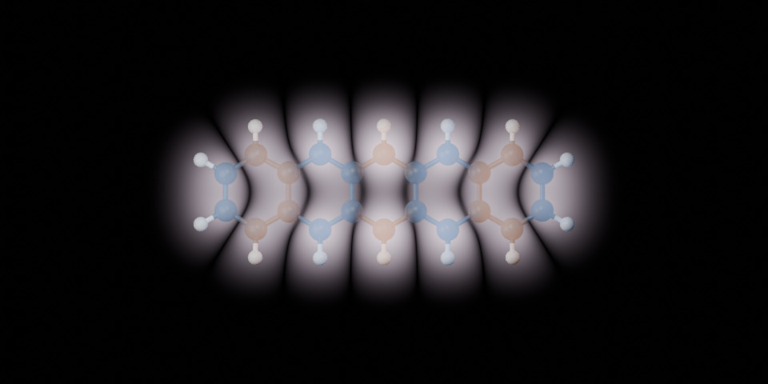

# Molecular-Orbitals-in-Blender

Render molecular orbitals directly in Blender's Cycle render engine using analytical Gaussian LCAO retrieved from DFT and translated into an OSL shader. The input is a PySCF job (example: pentacene anion [`DFT/example_C22H14.py`](DFT/example_C22H14.py)). Its RHF factory selects ROHF for this open-shell case and the supplied calculation is Hartree-Fock.

The rendering of electron orbitals is based on the project [Atomic-Orbitals-in-Blender](https://github.com/dom128/Atomic-Orbitals-in-Blender).



## Example  

1. Build the structure in Blender in _Windows PowerShell_:

   ```powershell
   $blender = "C:\Program Files\Blender Foundation\Blender 4.0\blender.exe"
   & $blender --background --factory-startup --python-exit-code 1 --python DFT/gen_structure.py -- --input DFT/example_C22H14.py --render
   ```

2. Calculate the orbitals with PySCF in _Linux/macOS/WSL_:

   ```shell
   python3 -m pip install numpy qc-iodata pyscf
   python3 DFT/example_C22H14.py --dry-run
   python3 DFT/example_C22H14.py --threads 8 --memory-mb 4000
   ```

3. Generate a direct OSL shader from the converged calculation (_Linux/macOS/WSL_):

   ```shell
   python3 DFT/gen_shader.py DFT/results/example_C22H14.molden --orbital HOMO --spin alpha
   ```

4. Render the orbital in Blender (_Windows PowerShell_):

   ```powershell
   & $blender --background --factory-startup --python-exit-code 1 --python DFT/gen_structure.py -- --input DFT/example_C22H14.py --shader DFT/results/example_C22H14_alpha_homo.osl --output DFT/results/example_C22H14_orbital.blend --render
   ```

**Result:**
The shader allows visualizing the amplitude or alternatively the orbital probabilty. The wave-function's phase is encoded in the shader color.


## Notice
Covalent radii are used in workflow.py, which are taken from [Cordero et al.](https://doi.org/10.1039/b801115j). The DFT input in example_C22H14.py is adapted from a GAMESS input file generated with Avogadro. The code in this project was mostly generated with ChatpGPT version 6.1 and is based on the previous project Atomic-Orbitals-in-Blender.
